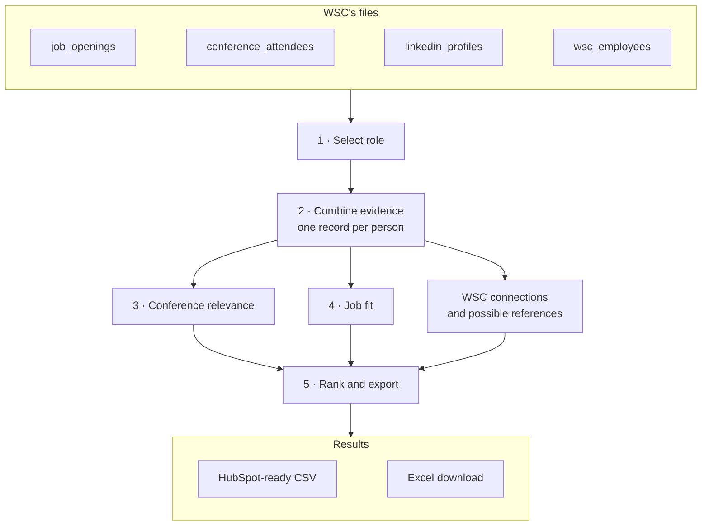

# Schema and flow

**Output:** a ranked candidate list for one selected role, explaining fit, gaps, and potential employee references. The pipeline in `pipeline/` implements this contract; a live HubSpot import has not been tested. Scoring rules: [How candidates are ranked](scoring.md).

## Flow

| Step | Input → action → output |
|---|---|
| 1. Select role | `job_id` + `job_openings.csv` → load the role's requirements and, when given, its own criteria (below). An unknown `job_id` stops with the list of valid IDs. |
| 2. Combine evidence | Read each file strictly (a broken quote, a row of the wrong width or an ambiguous header stops with its line and column) and check it has its required columns. Group attendee rows into event editions ([importing and events](additional-info/importing-and-events.md)). Attendees + LinkedIn profiles, matched by normalized profile URL; connections + employees, matched by employee ID; candidate and employee work histories compared for shared employers → candidate records with source evidence. |
| 3. Assess conference relevance | Skills, industry, and `conference_domain` → relevance and explanation for each event: fit with the event's topic, not with a job. It does not sort the pool or exclude anyone from job matching; it is reported in `event_assessments` and on the integration demo's HubSpot event activities. |
| 4. Assess job fit | Candidate evidence + role requirements → skill counts, recommendation, reasons, gaps, and next check, using the [scoring rules](scoring.md). |
| 5. Rank and export | Recommendations → `output/candidates_<job_id>.csv`. All four jobs are included. Identical inputs and rules produce identical files. The recruiter view also offers the same rows as an Excel file for reading ([export formats](additional-info/export-formats.md)). |

Keep one person with all their attendance records: rows sharing a LinkedIn URL (any spelling of it) are one person, and a row with no URL joins the one LinkedIn person with its email. Never merge by name alone. Ambiguous identities stay separate, each with its own durable person ID (`candidate_key`, below) and visible warnings, and are held for review; missing profiles remain eligible for review. One person at one event edition is one attendance ([importing and events](additional-info/importing-and-events.md)).

## Role criteria columns

`job_openings.csv` has two **optional** columns for a role's own criteria. They are what the demo's New position dialog writes after the recruiter confirms the suggested criteria; a role can also carry them in the file.

| Column | Format | Meaning |
|---|---|---|
| `core_skills` | Semicolon list, e.g. `Kubernetes;Terraform;CI/CD;Monitoring` | The role's core discipline. Any one on the profile, by name or an accepted alias ([equivalents](scoring.md#accepted-equivalents)), makes the person relevant; none → not recommended for this role. |
| `must_have_skills` | Semicolon list, e.g. `AWS` | Each must be on the profile, by name or alias, for the shortlist; a related skill is not enough. Checked on the profile even when it is not also a required skill. |

A role uses its written policy in `pipeline/rules.ts` if it has one (JOB001–JOB004), else these columns, else the provisional default ([scoring](scoring.md#the-shortlist-checks)). Absent columns, or empty cells, behave exactly as before: the supplied file has neither, and its four roles score the same either way. Absent columns are not warned about.

## Output fields

**One row per person per selected job; separate files for different jobs.** Put shortlisted people first. Source files retain the detailed evidence.

| Group | Columns | Purpose |
|---|---|---|
| Recommendation | `recommendation`, `shortlist_rank`, `tie_note`, `outcome_reason`, `fit_evidence`, `skill_gaps`, `seniority_evidence`, `industry_match_evidence` | Why this person fits, what is unconfirmed, and their position. Written for a recruiter: reasons cite the profile skill used, and related-skill or likely matches are labelled ("PyTorch: only a related skill (Deep Learning)", "Object Detection: likely (from Sports CV), please confirm"). |
| Skill counts | `required_skills_on_profile`, `required_skills_likely`, `required_skills_total`, `required_skills_needed`, `nice_to_have_on_profile`, `nice_to_have_total`, `industry_match` | The counts behind the outcome and the ranking, so anyone can recheck them. |
| Person | `candidate_key`, `source_contact_ids`, `full_name`, `firstname`, `lastname`, `email`, `linkedin_url`, `current_company`, `current_title`, `years_experience` | Identify the person. `candidate_key` is the person's durable ID: the published `C-HS…` ID for the supplied attendees, otherwise `P-` plus a hash of their LinkedIn URL, email or source ID and name; it does not change when they attend another event ([identity and history](additional-info/identity-and-history.md)). `firstname` is the first word of `full_name` and `lastname` the rest ("Maria de la Cruz" → Maria / de la Cruz); a one-word name leaves `lastname` blank. Check unusual name orders before import. Experience is total experience, including internships, not necessarily time in the specialty. |
| Role and history | `job_id`, `job_title`, `event_assessments`, `assessment_version` | Identify the role and rule version. Each event (one per event edition the person attended) keeps its date, name, domain, relevance with reason, HubSpot ID, source and notes, plus `event <id>` when an event ID was supplied. |
| References | `employee_connections`, `connection_count`, `connection_status`, `possible_references` | Listed connections: resolved employee names, IDs and titles. Possible references: employees who shared an employer in overlapping years. Kept apart; neither is scored. |
| Review | `profile_status`, `data_quality_flags`, `review_next_step`, `comeet_status`, `job_interest` | Explain missing/conflicting data and what to check. Comeet status and job interest are `unknown` in this exercise; in production a scheduled sync fills Comeet status ([design](design.md#production-version)). |

Export UTF-8 CSV with headers. Values are the same normalized values as the assessment (surrounding whitespace trimmed on import), not sanitized for formulas: this file is for CRM import, not for opening in a spreadsheet program, which may read a value like `=1+2` as a formula ([export formats](additional-info/export-formats.md)). Years, counts, and ranks are numbers; other fields are text. List entries share a cell, separated by `; ` (events by ` | `). Keys, role, version, statuses, and explanations are always filled. Unavailable source values are blank and flagged; conflicting values (e.g. two emails for one person) are left blank and both are listed in the flags. Rank starts at 1, tied people share a rank, and rank is blank outside the shortlist. Use `none identified` for no skill gaps, `none` for no quality flags, `none listed` for no connections, and `none found` for no possible references. Skill counts are blank when there is no usable profile.

`recommendation` is `shortlist`, `needs_review`, or `not_recommended_for_role` (no evidence of the role's core discipline; still in the pool for other roles). Rows are ordered shortlist first, then needs review, then not recommended; within each, by skill counts. `profile_status` is `matched`, `missing_url`, `unmatched`, `invalid_url`, or `conflict`. Count only resolved employee IDs: an empty source list gives 0 and `none_listed`; unresolved IDs give `partially_resolved`, even if none resolve. An unavailable profile gives a blank count and `unknown`. An industry match is assessed only where that role's policy defines one (JOB001).

## HubSpot preparation

Map `email` to Email, `firstname` to First name, `lastname` to Last name, and other columns to configured `talent_<column>` contact properties, using Number or text as above. Synthetic `HS...` IDs are source identifiers, not HubSpot Record IDs. Resolve identity/email conflicts before import. [HubSpot import guide](https://knowledge.hubspot.com/import-and-export/understand-the-import-tool).

Contact properties hold one selected-job snapshot: another job can overwrite it. Preserve per-job results. Blank CSV cells do not clear old values, including a former shortlist rank, so production updates need an explicit clearing policy. [HubSpot file requirements](https://knowledge.hubspot.com/import-and-export/set-up-your-import-file).

Automated tests (`npm test`) cover missing/conflicting profiles, repeat attendees, duplicates, unresolved connections, visible skill gaps, and connections unable to outrank clearly stronger qualifications, using synthetic fixtures in `tests/fixtures/`.
