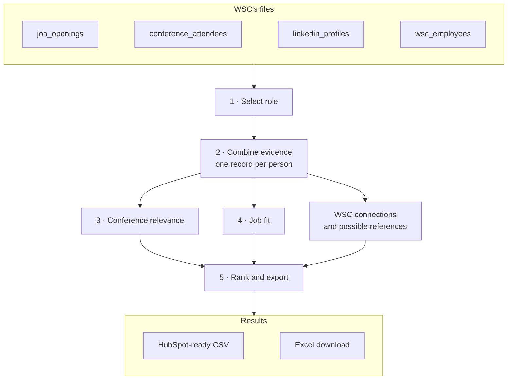

# Schema and flow

**Each role gets a ranked candidate list with reasons, gaps and possible employee references.** The CLI and both views use the same assessment code. A live HubSpot import has not been tested. See [scoring rules](scoring.md).

## Flow

1. **Select a role** from `job_openings.csv`, with its own criteria when given ([below](#role-criteria-columns)). Job IDs match in any letter case; an unknown ID stops the run and lists valid IDs, and two IDs differing only by case are rejected when the files are read.
2. **Join the evidence:** attendees, LinkedIn profiles and employee histories. Broken CSVs or missing required columns stop the run.
3. **Assess event relevance** from skills, industry and event topic. This describes attendance; it never changes job fit or ranking.
4. **Assess job fit:** required skills, experience, gaps and a next step. Skills written differently ("K8s") count through the saved [skill variants](scoring.md#skill-variants); `--learn-skills` asks Claude about unfamiliar words first.
5. **Rank and export:** one CSV per selected role (`output/candidates_<job_id>.csv`); the view also offers Excel. A job ID that is empty or contains path separators or control characters cannot name an export file. The supplied output covers all four roles. Identical inputs and rules give identical results.

People match by LinkedIn URL, or by email when it identifies one person. Names alone never merge records. Ambiguous identities stay flagged for review; missing profiles do too. One person can have several events, but one event edition counts once. See [importing and events](additional-info/importing-and-events.md).

## Role criteria columns

`job_openings.csv` has two **optional** columns for a role's own criteria. The demo's New position dialog writes them after the recruiter confirms the suggested criteria; a role can also carry them in the file.

| Column | Format | Meaning |
|---|---|---|
| `core_skills` | Semicolon list, e.g. `Kubernetes;Terraform;CI/CD;Monitoring` | The role's core discipline. Any one on the profile, by name or an accepted alias ([equivalents](scoring.md#accepted-equivalents)), makes the person relevant; none → not recommended for this role. |
| `must_have_skills` | Semicolon list, e.g. `AWS` | Each must be on the profile, by name or alias, for the shortlist; a related skill is not enough. Checked on the profile even when it is not also a required skill. |

A role uses its written policy in `pipeline/rules.ts` if it has one (JOB001–JOB004, matched in any letter case), else these columns, else the provisional default ([scoring](scoring.md#the-shortlist-checks)). Absent columns or empty cells behave exactly as before and are not warned about: the supplied file has neither, and its four roles score the same either way. The demo adds a new role by column name, so a jobs file with these columns reordered or absent stays valid.

## Output fields

**One row per person per role, including people who need review or do not fit.** Engineers can use this complete column reference for imports.

| Group | Columns | Meaning |
|---|---|---|
| Recommendation | `recommendation`, `shortlist_rank`, `tie_note`, `outcome_reason`, `fit_evidence`, `skill_gaps`, `seniority_evidence`, `industry_match_evidence` | Outcome, rank, evidence and gaps. Related or inferred skills are labelled as unconfirmed. A needs-review `outcome_reason` names the gap ("2 of 5 required skills on the profile (needs 3); 1 more likely (Machine Learning for PyTorch), please confirm; missing Object Detection, AWS"). |
| Skill counts | `required_skills_on_profile`, `required_skills_likely`, `required_skills_total`, `required_skills_needed`, `nice_to_have_on_profile`, `nice_to_have_total`, `industry_match` | Counts used for assessment and ranking. Only JOB001 has an industry-match rule. |
| Person | `candidate_key`, `source_contact_ids`, `full_name`, `firstname`, `lastname`, `email`, `linkedin_url`, `current_company`, `current_title`, `years_experience` | Durable person ID and source details. Names split at the first space; check unusual name orders. Experience includes internships and may cover other specialties. |
| Role and history | `job_id`, `job_title`, `event_assessments`, `assessment_version` | Role and rule version; each event's date, topic, relevance, source, notes and supplied IDs. |
| References | `employee_connections`, `connection_count`, `connection_status`, `possible_references` | Listed connections and shared-employer overlaps, kept separate. Connections only break exact fit ties; possible references never affect rank. |
| Review | `profile_status`, `data_quality_flags`, `review_next_step`, `comeet_status`, `job_interest` | Missing or conflicting evidence and next check. CSV Comeet status and interest are `unknown`; the views use separate fictional history. |

`candidate_key` uses the supplied people's published `C-HS…` IDs, otherwise a `P-` hash derived from identifiers. It stays stable across repeat attendance. See [identity and history](additional-info/identity-and-history.md).

### Values and ordering

| Field | Contract |
|---|---|
| Recommendation | `shortlist`, `needs_review`, `not_recommended_for_role`, in that order, then ranked by fit. Everyone remains in the pool. |
| Rank | Starts at 1; ties share a rank. Blank outside the shortlist. |
| Profile status | `matched`, `missing_url`, `unmatched`, `invalid_url`, `conflict`. Skill counts are blank without a usable profile. |
| Connections | Count resolved employee IDs only. Empty list: `0` / `none_listed`. Any unresolved IDs: `partially_resolved`. No profile: blank / `unknown`. |
| Missing values | Unavailable source values are blank and flagged. Conflicting values, such as emails, stay blank with details in flags. |
| Empty findings | `none identified` for skill gaps; `none` for quality flags; `none listed` for connections; `none found` for references. |

CSV uses UTF-8 headers, numbers for years/counts/ranks and text elsewhere. Lists use `; `; events use ` | `. Keys, role, version, statuses and explanations are filled. Import trims surrounding whitespace.

**Use Excel for spreadsheet reading.** The CSV preserves values for CRM import, including text a spreadsheet might interpret as a formula. See [export formats](additional-info/export-formats.md).

## HubSpot preparation

Map `email`, `firstname`, `lastname` to HubSpot's matching contact fields; map the rest to `talent_<column>` properties with the types above. Synthetic `HS...` IDs are source IDs, not HubSpot Record IDs. Resolve identity conflicts first. Import talent-only contacts as non-marketing contacts, and do not map Contact owner or Lifecycle stage, so an import never overwrites a sales or marketing owner ([design](design.md#production-version)). [Import guide](https://knowledge.hubspot.com/import-and-export/understand-the-import-tool).

These properties hold **one role's snapshot**. Importing another role can overwrite it. Blank CSV cells do not clear old values, including old ranks; production needs explicit clearing. [File requirements](https://knowledge.hubspot.com/import-and-export/set-up-your-import-file).

`npm test` checks matching, duplicates, missing evidence, references and ranking with synthetic fixtures.

## Production: multiple roles

**Proposed, not connected:** keep each person's results for every role in a separate assessment store. Save immutable revisions keyed by person, role, input version and rule version, with one current revision per person–role pair.

Each role gets Shortlist and Needs review lists. The service manages membership through HubSpot's `MANUAL` lists API; a contact can belong to several lists. The app card reads that role's rank, reasons and gaps from the assessment store. Shared contact properties cannot supply different values in each role's native list columns. [Lists API](https://developers.hubspot.com/docs/api-reference/legacy/crm/lists/guide#manage-list-membership).

Publish one run per role at a time, reject superseded runs and retry membership differences. Notify recruiters only when that revision's lists match its results. Lists may briefly lag; the store and HubSpot do not update atomically. List limits, permissions, app-card access and column layout still need a test account check.
