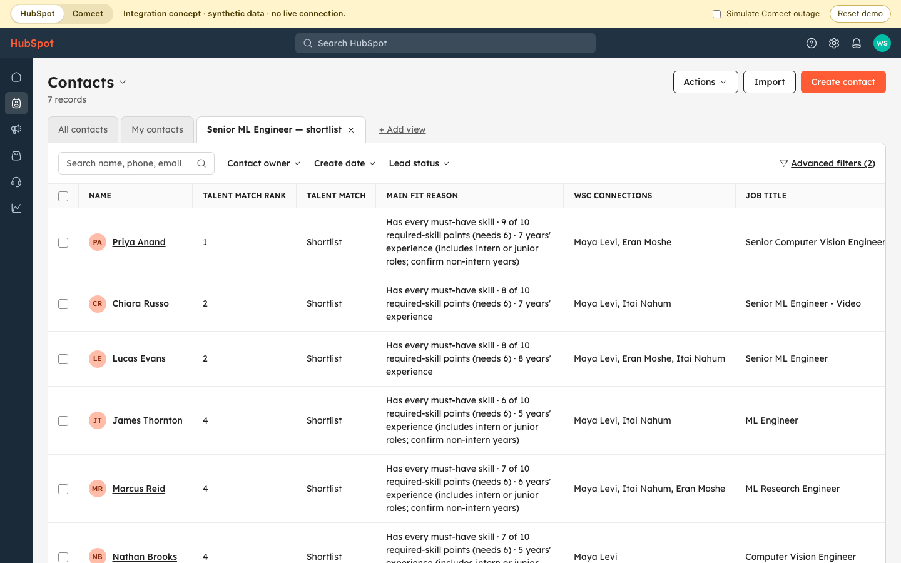
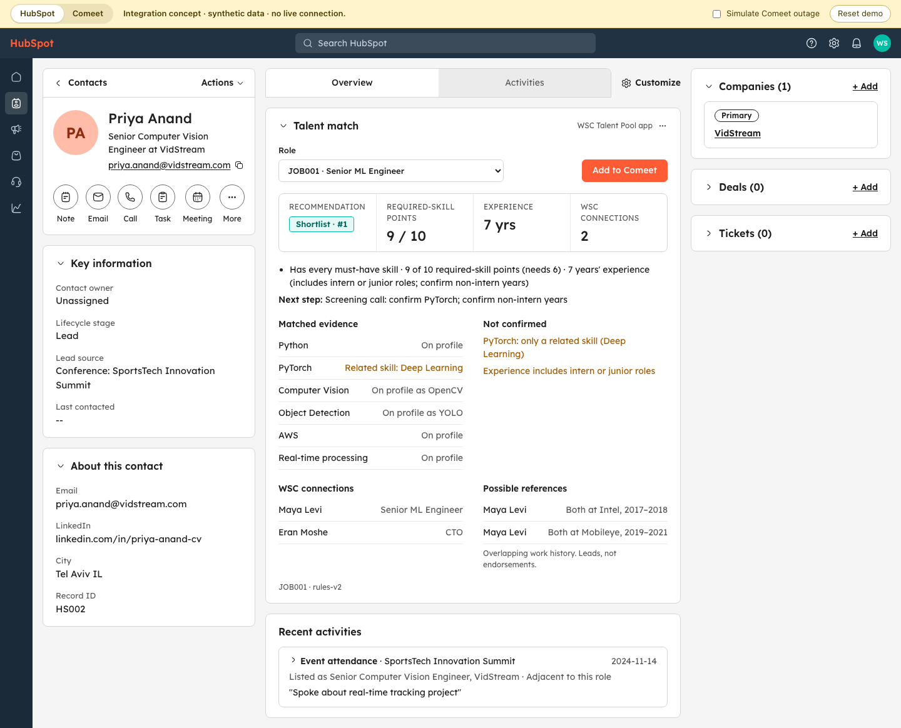
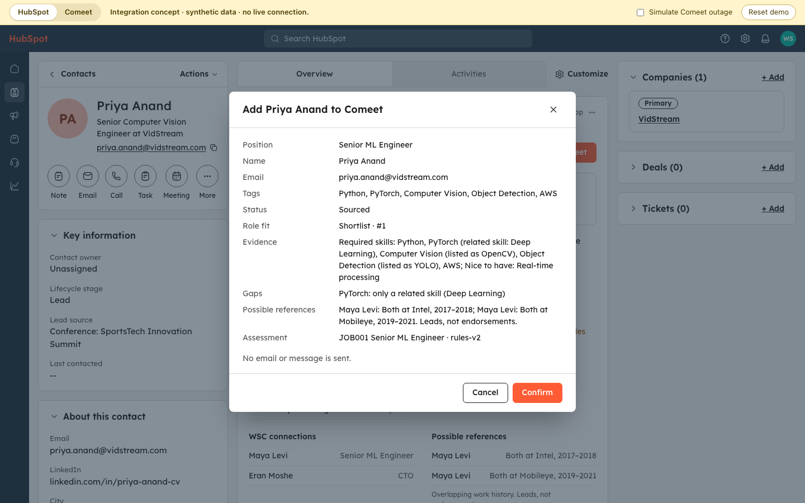
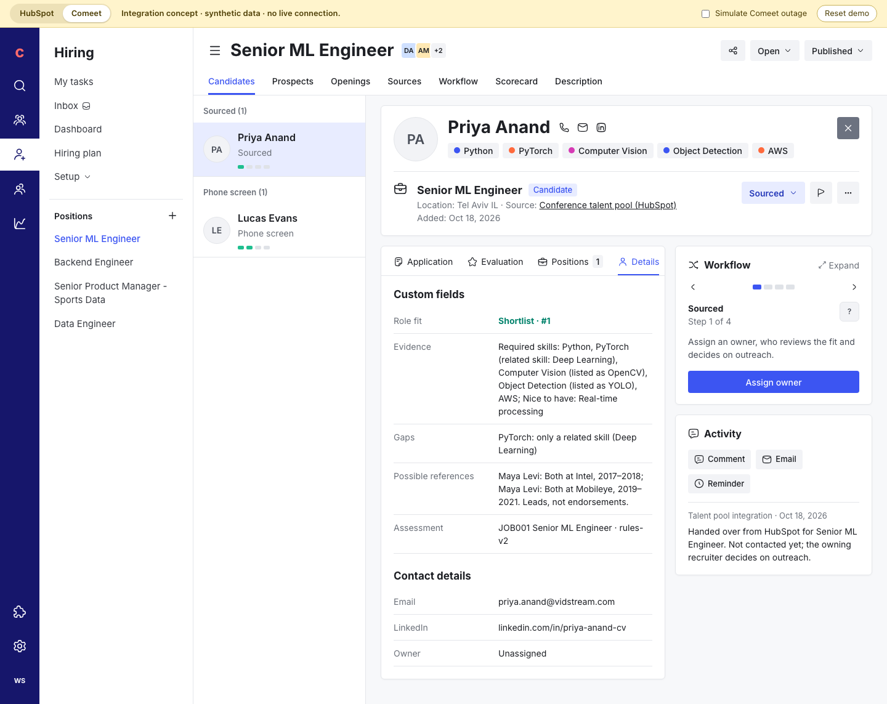
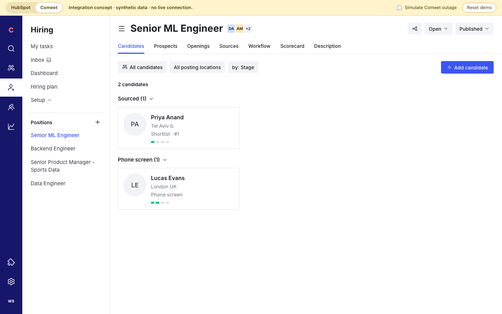

# HubSpot → Comeet integration demo

A clickable concept of the production recruiter experience: review the talent pool inside HubSpot, then hand a person into Comeet for a role. Plan: [docs/native-integration-demo-plan.md](../docs/native-integration-demo-plan.md).

**Everything here is simulated.** Synthetic data, no HubSpot or Comeet account, no network calls. Each screen is drawn in that product's layout, approximated from public screenshots; no logos or product assets are used. The **HubSpot | Comeet** switch in the yellow strip works like two browser tabs. Every recommendation, rank, gap and reference comes from the same `pipeline/` the CLI and recruiter view use.

```bash
npm run demo:integrations   # http://localhost:5173
npx playwright test --project integration-demo
```

## Walkthrough

1. **HubSpot shortlist.** The saved view "Senior ML Engineer — shortlist" lists the 7 JOB001 shortlisted contacts with rank, recommendation, main fit reason and WSC connections. Open **Priya Anand**.
   
2. **Contact record.** The **Talent match** app card sits full-width in the middle column's Overview tab and shows the selected role's recommendation, matched evidence, what is not confirmed, seniority, WSC connections and possible references (leads, not endorsements). Switch **Role** to see her other assessments: JOB002 reads "Not recommended for this role", and JOB001 is unchanged when you switch back.
   
3. **Handoff.** **Add to Comeet** previews exactly what will be sent: position, name, email, status Sourced, and the custom fields. Nothing is sent until **Confirm**, and no email goes out.
   
4. **Comeet candidate.** **Open in Comeet** switches to Comeet on the Senior ML Engineer position, with the candidate list narrowed beside the profile. The profile shows matched skills as tags, status Sourced (not Applied), the custom fields on the Details tab (role fit, evidence, gaps, possible references, assessment version), the Workflow card with an unassigned owner and next step, and the handoff note in Activity.
   
5. **Comeet position.** Close the profile to see the position's candidates grouped by step: the new Sourced candidate and Lucas Evans in Phone screen.
   

Also try:

- **Already in Comeet:** open **Lucas Evans** → Add to Comeet. He is in a fictional phone-screen process, so the dialog shows the owner and next step and links to that record instead of creating one.
- **Repeat handoff:** add the same person twice. The second attempt links to the first record.
- **Outage:** tick **Simulate Comeet outage**, then Confirm. The dialog says nothing was created; untick and **Try again**.
- **Reset demo** clears every handoff.

## What is simulated

| Piece | In the demo | In production |
|---|---|---|
| Shortlist list | Built from `assessJob('JOB001')` | HubSpot saved view on synced contact properties |
| Talent match card | React component | HubSpot UI extension (app card) reading the assessment store |
| Role switching | Reads per-person, per-role, per-version assessments held in memory (`assessments.ts`) | Same keys, in the assessment store |
| Comeet lookup and create | In-memory service (`comeet.ts`), fictional positions and one active candidate (`fixtures.ts`) | Comeet Recruiting API (Enterprise; access through Comeet support) |
| Comeet position and profile | Approximate layout with configured custom fields and tags | Comeet's own pages |
