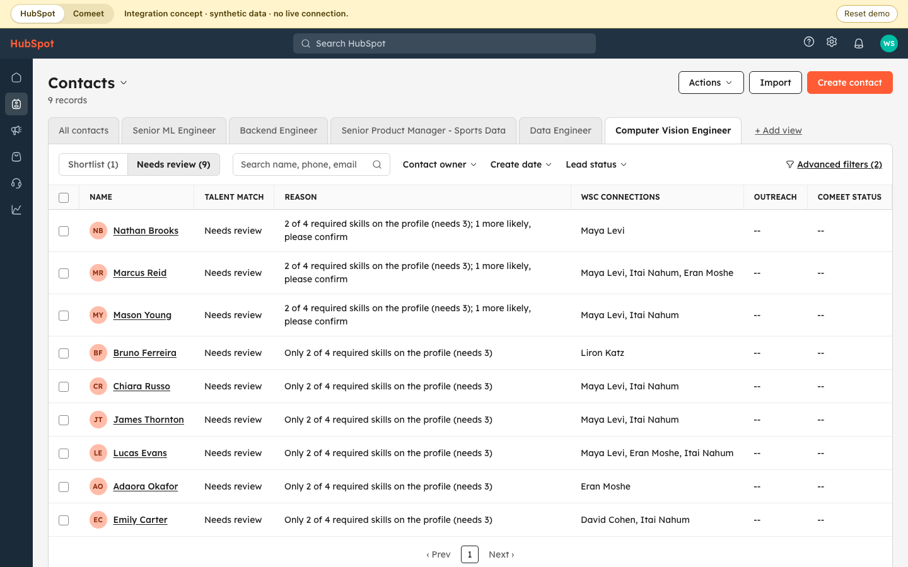

# Production preview: HubSpot → Comeet

**Live:** https://wsc-talent-pool-demo.vercel.app/ · the recruiter view links to it from its footer.

## What this is

The [recruiter view](../README.md#try-the-recruiter-view) is the assignment's own screen. This preview shows the same results where WSC's recruiters already work: contacts and the overnight talent match in **HubSpot**, and the people worth pursuing handed into **Comeet**, the applicant tracking system where roles are opened. On the discovery call the recruiter said she opens roles in Comeet and wants data moving between systems rather than another tool, so the production version keeps recruiting inside those two products. This preview is what that would look like.

**Everything here is simulated.** Synthetic data, no HubSpot or Comeet account, no network calls. Each screen is drawn in that product's layout, approximated from public screenshots, with no product logos or assets. The **HubSpot | Comeet** switch in the yellow strip works like two browser tabs; only the strip and the AI-criteria header say "simulated". Every recommendation, rank, gap and reference comes from the same `pipeline/` the CLI and recruiter view use.

**Start in HubSpot, not Comeet.** Comeet opens empty because nothing has been handed over yet; that is the point. Conference contacts stay in HubSpot, and Comeet only receives the people a recruiter chooses. The seeded candidates already in Comeet (added by hand, before any integration) have empty Role fit, Evidence and Gaps fields; a person handed over from HubSpot arrives with all of them filled.

The whole story in four steps:

1. In **HubSpot**, the notification "Talent match ran overnight" → **View results** opens the Senior ML Engineer shortlist.
2. Open **Priya Anand** → **Add to Comeet** → **Confirm**. Nothing is emailed.
3. **Open in Comeet**: she is on the position's **Prospects (1)** tab as Sourced, owned by the role's recruiter, with role fit, evidence, gaps, possible references and the handoff note.
4. Back in **HubSpot**, her card reads "In Comeet: Sourced". The status came back on its own.

Import and New position (steps 7 to 9 below) show what happens when a new spreadsheet or a new role arrives.

```bash
npm run demo:integrations   # http://localhost:5173
npx playwright test --project integration-demo
```

## Walkthrough: the morning after a conference

1. **Overnight run.** The demo opens in HubSpot with one notification: "Talent match ran overnight — 75 conference contacts from 4 events scored for 4 open roles." Its single **View results** link opens the first role's view; the per-role counts live on the saved-view tabs. One line per event, with one link, is a design choice to keep the notification short, not a HubSpot limit. In production this runs after the event's contacts land in HubSpot and are enriched.
   
2. **Shortlist and Needs review.** **View results** opens the Senior ML Engineer view on **Shortlist (6)**, with rank, fit reason, WSC connections, outreach for that role and Comeet status. A shortlist reason is short ("Must-haves met · 4/5 listed skills · 7 years reported; experience needs confirmation"); the full evidence is on the contact's card. **Needs review (6)** switches the same view to the people a recruiter should check. Every open role has its own tab (Senior Product Manager - Sports Data: 0 shortlist, 5 needs review), and returning from a contact keeps the group you were on.
   
3. **Contact record.** Open **Priya Anand**. **Key information** shows Contact owner Unassigned, Contact type Talent lead, Lifecycle stage Lead and Marketing contact status Non-marketing contact; **About this contact** shows a simulated numeric Record ID with Source ID "HS002" beneath it, and City and Country/Region as separate fields. The **Talent match** app card in the Overview tab shows the Role selector with "Recruiter for this role: Neta Harel" (switch **Role** and the name follows the role: Gal Ofer for Backend Engineer, Ronit Sela for Senior Product Manager, Amit Sasson for Data Engineer). Below are the recommendation, required skills on the profile, matched evidence, what is not confirmed, and one list of WSC people: "Connection" for a listed mutual connection, "Same company, 2y overlap" for someone who shared an employer at overlapping dates (that does not prove they worked together). The assessment version ("JOB001 · rules-v4") is behind **Details**. Outreach from the recruiter app appears in **Recent activities** as HubSpot logs it: a sent invite is a logged email, a draft is a note, a reference request is a task. Each **Event attendance** there shows the person's relevance to that event's topic (for example "Relevance to event topic (Sports Technology & Analytics): Relevant" for Jack Thomas); that is not a job verdict, which is the card's **Recommendation** for the selected role. **Last contacted** changes only for a sent invite. Noah Anderson shows the seeded example: declined Backend Engineer, still open on the Data Engineer shortlist. **Emily Carter** (Senior ML Engineer, Needs review) is the seeded customer contact: Contact owner "Marketing · Noa Peretz", Contact type "Customer contact · Talent lead", Lifecycle stage Customer, Marketing contact.
   
4. **Handoff.** **Add to Comeet** previews what will be sent, including Prospect status Sourced and "Owner in Comeet: Neta Harel", the role's recruiter. Nothing is sent until **Confirm**, and no email goes out. If the saved history cannot be read or Comeet does not answer, the dialog says so, records nothing as sent and offers **Try again**.
   
5. **Comeet.** **Open in Comeet** opens the position on its **Prospects (1)** tab, not Candidates; the list heading reads "Prospects · Sourced (1)". Her record shows status Sourced, Step 1 of 4 of the prospect workflow (Sourced → Contacted → Responded → Interested), owner Neta Harel and the next step "Neta reviews the fit and decides on outreach.", with tags, the custom fields on Details and the handoff note. The **Candidates** tab keeps people already in a process (Ryan Patel, Data Engineer). Scarlett Green, an uncontacted lead, is a Sourced prospect for Data Engineer. The tab layout approximates Comeet; it should be matched to WSC's own Comeet setup.
   
6. **Status comes back.** Back in HubSpot, the card says "In Comeet: Sourced" with **Open in Comeet** instead of Add, the record shows the Comeet status, and the shortlist's Comeet status column updates (Priya Anand: Sourced). The Contact owner does not change: Priya stays Unassigned, and after the same handoff Emily Carter stays "Marketing · Noa Peretz", Customer, Marketing contact. Handing the same person over for the same role again creates no duplicate: the card only offers **Open in Comeet**, and the position still lists her once.
   
7. **Manual import.** **Import** in HubSpot takes a spreadsheet from an event (or **Use sample file**). It is checked first: 4 new contacts, and 1 repeat attendee (James Thornton) added as an event to his existing contact, no duplicate. The preview says once that they are imported as non-marketing contacts; new contacts get Lifecycle stage Other. After import every role is re-scored and a one-line notification says so; its **View results** opens Senior ML Engineer, now 7 shortlist (led by Noa Barak) and 7 needs review. A file with missing columns or broken CSV (a quote never closed, a row of the wrong width, a repeated header) imports nothing and names the line. A later edition of a known conference (SportsTech Innovation Summit 2026 after 2024) imports as its own event, labelled with its year. A row is skipped only when it is an exact retry (same person, edition and date, nothing new), so importing the same file twice adds nothing the second time; a row that brings a new email, LinkedIn URL, source ID, name or note is kept and checked like any other ([importing and events](../docs/additional-info/importing-and-events.md)).
   
8. **New role.** In Comeet, **+** next to Positions opens **New position**: title, department, seniority and a job description, prefilled with a Computer Vision Engineer example. Under **Suggested criteria** ("Suggested by AI from the description · simulated · edit before publishing") are four editable lists: Core skills (any one makes the person relevant), Must-have skills (each required for the shortlist), Required skills (60% needed for the shortlist) and Nice to have. Each row quotes the sentence behind it and is labelled "From description" or "AI suggestion" (Pose Estimation, inferred from "track players and the ball"). The suggestions are scripted, not a live model. Edit, remove or add rows, then **Publish position**; the confirmed lists become the role's criteria. Publishing is never blocked: with no core skills left, the dialog warns that any required skill will count (provisional). The new position's recruiter is you, the signed-in user.
   
9. **New role in HubSpot.** Publishing scores the whole pool for the confirmed criteria. HubSpot gets a notification with that role's counts and a new saved view. The prefilled example as suggested gives 1 shortlist, 9 needs review and 65 not recommended, and each review reason names the gap ("2 of 4 required skills on the profile (needs 3)"). For an unrelated role, change the title to "Site Reliability Engineer" and paste an SRE description (the one in `tests/role-examples.ts` suggests core Kubernetes, Terraform, CI/CD and Monitoring and must-have AWS): as suggested it gives 9 shortlist, 4 needs review, 62 not recommended ([rules](../docs/scoring.md#the-shortlist-checks)).
   

### History and safeguards

Comeet history comes from the same made-up file as the recruiter view (`data/demo/comeet.json`) and is checked by the handoff rule (`checkHandoff` in `view/activity.ts`: the invite rule minus what only matters for contacting).

- **An active process blocks.** Ryan Patel, in process for Data Engineer, shows "In progress · Phone screen" on that view, and his card has no **Add to Comeet** for any role. Re-imported with only his email, or with a `uk.linkedin.com` spelling of his URL, he is still recognised, so his process still blocks him.
- **An uncontacted lead can be added.** Scarlett Green can still be added for another role.
- **A past rejection warns.** A rejection for another role warns without blocking, in the recruiter app's words ("Rejected after technical interview for Computer Vision Engineer in Comeet · Jan 2024." on James Thornton's card). A withdrawal does not warn.
- **An unclear identity stops.** A different person sharing an existing candidate's email, in any position, is stopped for review instead of matched. A contact whose identity is unresolved (another name on Priya's LinkedIn URL, in any spelling such as `uk.linkedin.com`) cannot be added at all. A warning that two contacts share an ID always comes with this block for both.
- **History travels in the note.** Noah Anderson's Backend Engineer handoff is allowed, with his decline shown on the card and carried in the note; someone with nothing recorded gets "No contact recorded" ([invite versus handoff](../docs/additional-info/identity-and-history.md#invite-versus-handoff)).

**Reset demo** starts the session over: it discards imported contacts, positions added in Comeet, handed-off Comeet records and notifications. Imported contacts also go away when the page is reloaded. Reset demo does not clear the saved outreach history this browser keeps (that needs the site's data cleared; see [identity and history](../docs/additional-info/identity-and-history.md#stored-state-version-and-upgrade)).

## What is simulated

| Piece | In the demo | In production |
|---|---|---|
| Role results | In-memory assessments and saved views per role (`assessJob`) | Separate assessment store and Shortlist/Needs review list memberships for each role |
| Talent match card | React component | HubSpot UI extension (app card) reading the assessment store |
| Role switching | Reads per-person, per-role, per-version assessments held in memory (`assessments.ts`) | Same keys, in the assessment store |
| Recruiter per role | Invented recruiters on the four positions (`fixtures.ts`); a new position gets the signed-in user | The Comeet position's lead recruiter; how the owner is set on a handed-off prospect is still to verify with WSC's setup |
| Contact type, marketing status, owner | Set per contact in `contactProperties.ts`, with one seeded customer contact (Emily Carter) owned by marketing | HubSpot contact properties; talent-only contacts imported as non-marketing; owner and lifecycle stage never written by the integration |
| Record ID | Numeric, derived from the source ID (HS002 → 1002) | HubSpot's own record ID |
| Contact history | The recruiter app's seeded outreach plus this browser's saved history (`view/actionStore.ts`), mapped in `hubspotActivity.ts` | Logged emails, notes and tasks on the HubSpot contact; HubSpot sets Last contacted itself |
| Comeet lookup and create | In-memory service (`comeet.ts`), fictional positions (`fixtures.ts`), seeded from `data/demo/comeet.json`; a handoff creates a Sourced prospect | Comeet Recruiting API (Enterprise; access through Comeet support), `prospect_status` Sourced |
| Comeet position and profile | Approximate layout with Candidates and Prospects tabs, configured custom fields and tags | Comeet's own pages, as WSC has them configured |
| Overnight run and notification | Computed on load from `data/`; one HubSpot-style notification line per event | A scheduled job after event capture and enrichment; HubSpot notification or task |
| Comeet status in HubSpot | Read from the simulated Comeet | A scheduled sync reads each candidate's status from Comeet's Recruiting API (Comeet documents no status-change webhook) and writes a HubSpot contact property |
| Spreadsheet import | Validated, then appended to the same source tables (`sources.ts`) | HubSpot import, then the same scoring job |
| New role criteria | Scripted suggestions (`suggestCriteria.ts`: a deterministic extractor plus a per-example fixture), edited and confirmed in the dialog; the role is added to the jobs table by column name | Comeet "position created" webhook; an LLM suggests criteria from the job description and a recruiter confirms them before scoring |

**A person can fit several roles at once.** Production keeps person–role revisions separately. The service updates each role's lists, and the app card reads its rank and reasons from the store. The demo's role-specific list columns still need validation in HubSpot. See the [multi-role design](../docs/schema-and-flow.md#production-multiple-roles).

## What the real products support

These documented features support the proposal. WSC's plans, permissions and actual setup still need verification; this establishes a supported route, not a verified WSC installation.

| Need | Documented route |
|---|---|
| HubSpot lists and views | [Saved views](https://knowledge.hubspot.com/records/create-and-manage-saved-views) filter and choose columns; [service-managed list membership](https://developers.hubspot.com/docs/api-reference/legacy/crm/lists/guide#manage-list-membership) keeps each role's lists. Shared contact properties cannot hold a different rank for each simultaneous role. |
| Interactive contact card | [UI extensions](https://developers.hubspot.com/docs/apps/developer-platform/add-features/ui-extensions/overview), built with HubSpot's UI components and an integration service. HubSpot's docs say UI extensions for [private apps](https://developers.hubspot.com/docs/apps/legacy-apps/private-apps/build-with-projects/create-private-apps-with-projects), and the [serverless functions](https://developers.hubspot.com/docs/apps/developer-platform/add-features/serverless-functions/create-serverless-functions) they use, require Enterprise; a developer test account works while building. |
| HubSpot notifications | The workflow action [Send in-app notification](https://knowledge.hubspot.com/workflows/choose-your-workflow-actions). |
| Talent contacts off marketing | [Non-marketing contacts](https://knowledge.hubspot.com/records/marketing-contacts) cannot receive marketing emails or be in ad audiences; one-to-one emails and sequences still work, so talent contacts are also kept out of commercial campaign lists. |
| Event attendance | [Marketing events on contacts](https://knowledge.hubspot.com/integrations/view-marketing-events-on-contact-records) show registration and participation separately (Registered, Attended, Canceled, No Show); registration alone is not proof of attendance. |
| Comeet role changes | [Position webhooks](https://developers.comeet.com/reference/position-updates) cover creation, update and deletion. Candidate-status webhooks are not documented, so status comes back by scheduled sync. The [position object](https://developers.comeet.com/reference/positions-copy) names its lead recruiter (`users.lead_recruiter`). Since April 2026 the [changelog](https://developers.comeet.com/reference/changelog) also documents Leads endpoints, an alternative home for sourced prospects. |
| Comeet handoff | [Candidate creation](https://developers.comeet.com/reference/create-a-candidate-new) supports a position, `prospect_status` (Sourced, Contacted, Responded, Interested, Not interested, Do not contact), custom fields and a note. It has no owner field, so assigning the lead recruiter needs verifying in WSC's setup, and the API docs do not show screen layout. [Custom fields](https://recruit-support.sparkhire.com/hc/en-us/articles/40045151370267-Custom-candidate-fields) and customer [Recruiting API access](https://developers.comeet.com/reference/getting-started-comeet-customers) require Enterprise; API access involves Comeet support. |
