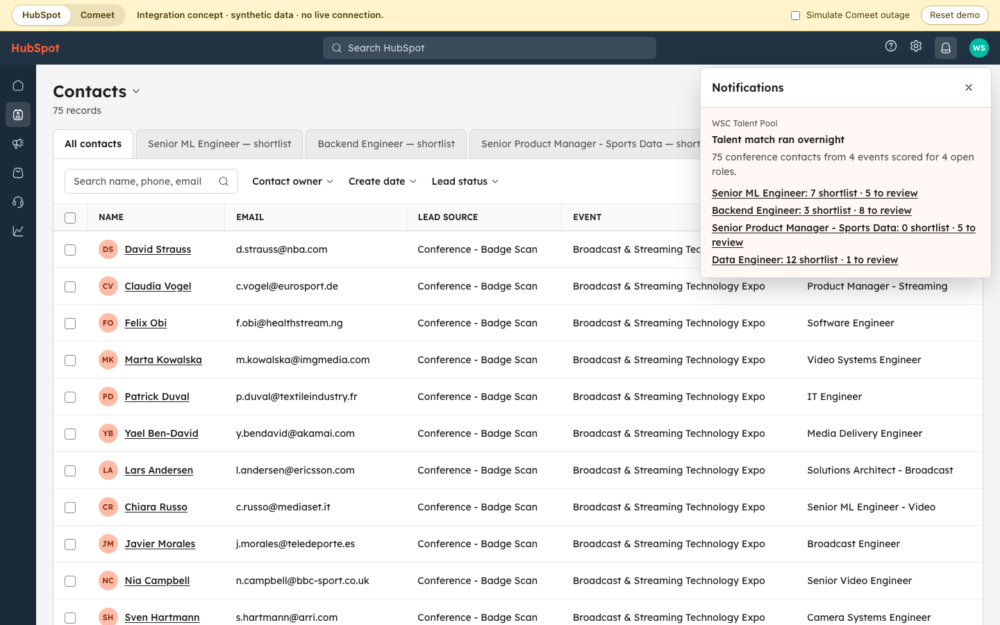
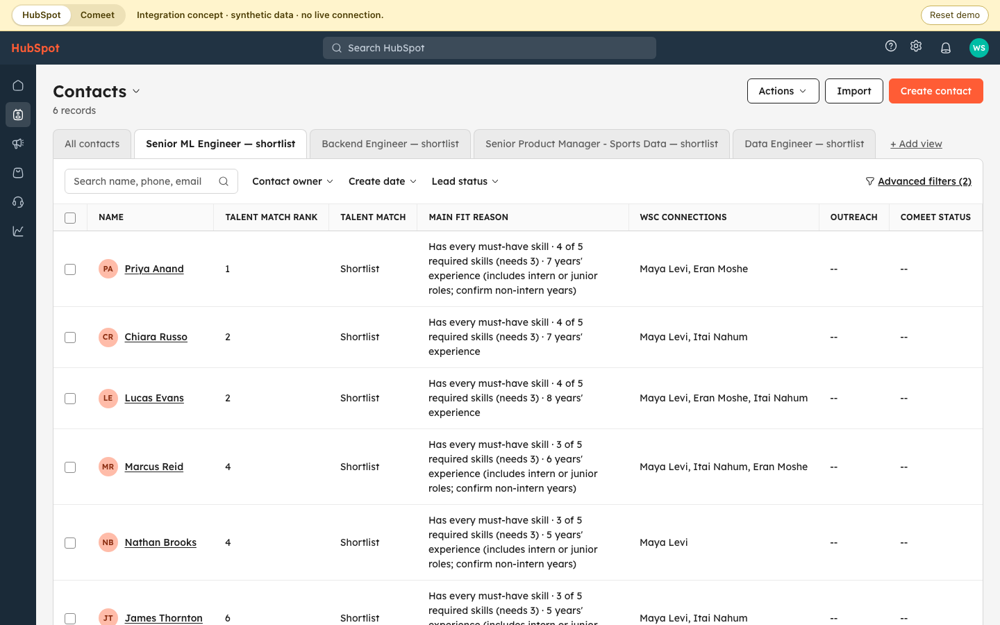
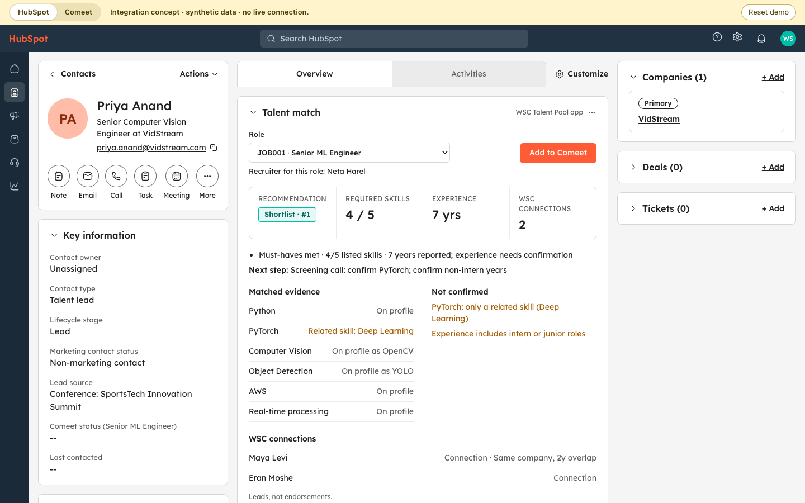
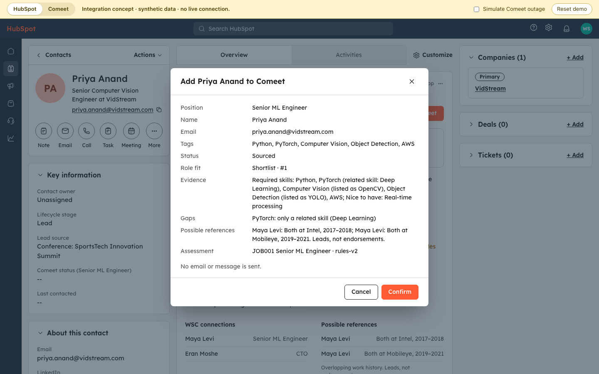
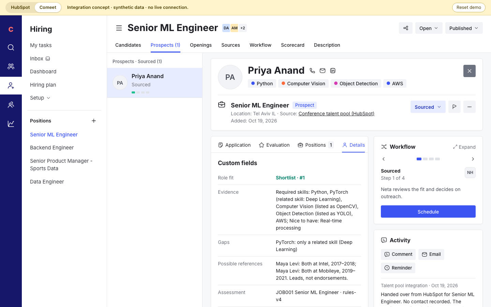
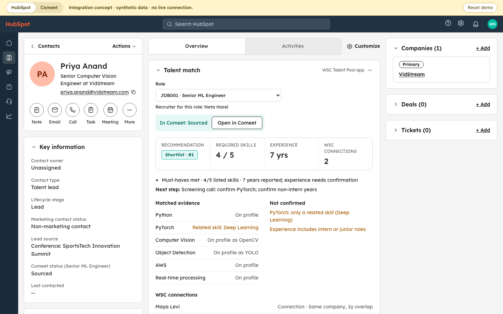
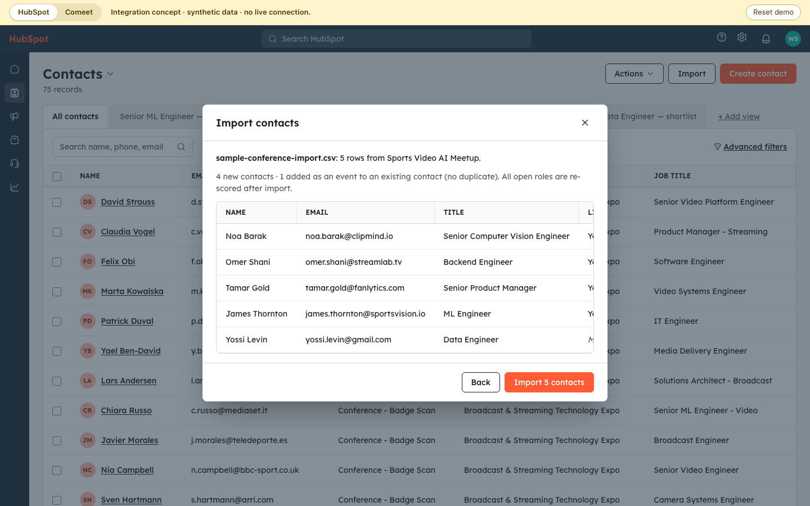
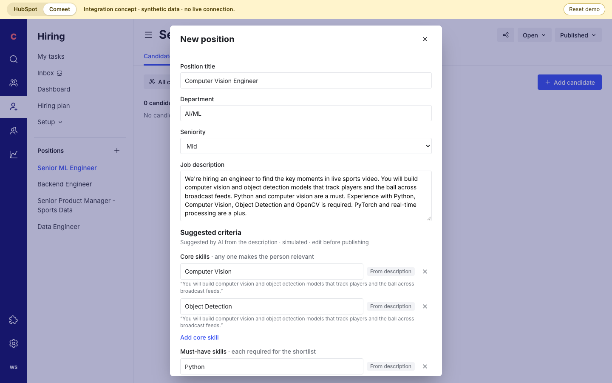

# HubSpot → Comeet integration demo

A clickable concept of the production recruiter experience: review the talent pool inside HubSpot, then hand a person into Comeet for a role. Plan: [docs/native-integration-demo-plan.md](../docs/native-integration-demo-plan.md).

**Everything here is simulated.** Synthetic data, no HubSpot or Comeet account, no network calls. Each screen is drawn in that product's layout, approximated from public screenshots; no logos or product assets are used. The **HubSpot | Comeet** switch in the yellow strip works like two browser tabs. Every recommendation, rank, gap and reference comes from the same `pipeline/` the CLI and recruiter view use.

```bash
npm run demo:integrations   # http://localhost:5173
npx playwright test --project integration-demo
```

## Walkthrough: the morning after a conference

1. **Overnight run.** The demo opens in HubSpot with a notification: the conference contacts were scored overnight for every open Comeet role, with a count per role. In production this runs after the event's contacts land in HubSpot and are enriched.
   
2. **Shortlist and Needs review.** Click **6 shortlist** next to Senior ML Engineer. The role's saved view lists the 6 with rank, fit reason, WSC connections, outreach for that role and Comeet status. **Needs review (6)** next to the filters switches the same view to the people a recruiter should check; each count in the notification opens its group directly (Senior Product Manager - Sports Data: 0 shortlist, 5 needs review). Every open role has its own view, and returning from a contact keeps the group you were on.
   
3. **Contact record.** Open **Priya Anand**. The **Talent match** app card in the Overview tab shows the recommendation, required skills on the profile, matched evidence, what is not confirmed, and one list of WSC people: "Connection" for a listed mutual connection, "Same company, 2y overlap" for someone who shared an employer at overlapping dates (that does not prove they worked together). Switch **Role** to read her other assessments. Outreach from the recruiter app appears in **Recent activities** as HubSpot logs it: a sent invite is a logged email, a draft is a note, a reference request is a task. Each **Event attendance** there shows the person's relevance to that event's topic (for example "Relevance to event topic (Sports Technology & Analytics): Relevant" for Jack Thomas); that is not a job verdict, which is the card's **Recommendation** for the selected role. **Last contacted** changes only for a sent invite: drafts, reference requests (they go to a colleague) and Comeet records do not count. Noah Anderson shows the seeded example: declined Backend Engineer, still open on the Data Engineer shortlist.
   
4. **Handoff.** **Add to Comeet** previews what will be sent. Nothing is sent until **Confirm**, and no email goes out.
   
5. **Comeet.** **Open in Comeet** opens her profile in the position: status Sourced (not Applied), tags, the custom fields on Details, the Workflow card and the handoff note.
   
6. **Status comes back.** Back in HubSpot, the card says "In Comeet: Sourced" with **Open in Comeet** instead of Add, the record shows the Comeet status, and the shortlist's Comeet status column updates (Priya Anand: Sourced). The Comeet history is the same made-up file the recruiter view uses (`data/demo_comeet.json`), checked by the handoff rule (`checkHandoff` in `view/activity.ts`, the invite rule minus what only matters for contacting): Ryan Patel, in process for Data Engineer, shows "In progress · Phone screen" on the Data Engineer view and his card has no **Add to Comeet** for any role; Scarlett Green, an uncontacted lead, can still be added; a past rejection for another role warns without blocking, in the same words as the recruiter app's invite panels ("Rejected after technical interview for Computer Vision Engineer in Comeet · Jan 2024." on James Thornton's card). A withdrawal does not warn. A different person sharing an existing candidate's email, in any position, is stopped for review instead of being matched, and a contact whose identity is unresolved (an email-only import of Ryan, another name on Priya's LinkedIn URL) cannot be added at all. Noah Anderson's Backend Engineer handoff is allowed, with his decline shown on the card and carried in the note; someone with nothing recorded gets "No contact recorded" ([invite versus handoff](../docs/identity-and-history.md#invite-versus-handoff)).
   
7. **Manual import.** **Import** in HubSpot takes a spreadsheet from an event (or **Use sample file**). It is checked first: 4 new contacts, and 1 repeat attendee (James Thornton) added as an event to his existing contact, no duplicate. After import every role is re-scored and a notification reports the new counts (Senior ML Engineer: 7 shortlist, led by Noa Barak, and 7 needs review). A file with missing columns or broken CSV (a quote never closed, a row of the wrong width, a repeated header) imports nothing and names the line. A later edition of a known conference (SportsTech Innovation Summit 2026 after 2024) imports as its own event, labelled with its year. Rows for someone already recorded at that edition are skipped, so importing the same file twice adds nothing the second time ([importing and events](../docs/importing-and-events.md)).
   
8. **New role.** In Comeet, **+** next to Positions opens a new position (prefilled). Publishing it scores the whole pool for that role; HubSpot gets a notification and a new saved view.
   

**Reset demo** starts over.

## What is simulated

| Piece | In the demo | In production |
|---|---|---|
| Shortlist list | Built from `assessJob('JOB001')` | HubSpot saved view on synced contact properties |
| Talent match card | React component | HubSpot UI extension (app card) reading the assessment store |
| Role switching | Reads per-person, per-role, per-version assessments held in memory (`assessments.ts`) | Same keys, in the assessment store |
| Contact history | The recruiter app's seeded outreach plus this browser's saved history (`view/actionStore.ts`), mapped in `hubspotActivity.ts` | Logged emails, notes and tasks on the HubSpot contact; HubSpot sets Last contacted itself |
| Comeet lookup and create | In-memory service (`comeet.ts`), fictional positions (`fixtures.ts`), seeded from `data/demo_comeet.json` | Comeet Recruiting API (Enterprise; access through Comeet support) |
| Comeet position and profile | Approximate layout with configured custom fields and tags | Comeet's own pages |
| Overnight run and notification | Computed on load from `data/`; a HubSpot-style notification | A scheduled job after event capture and enrichment; HubSpot notification or task |
| Comeet status in HubSpot | Read from the simulated Comeet | A scheduled sync reads each candidate's status from Comeet's Recruiting API (Comeet sends no status-change webhook) and writes a HubSpot contact property |
| Spreadsheet import | Validated, then appended to the same source tables (`sources.ts`) | HubSpot import, then the same scoring job |
| New role | Appended as a job; scored immediately | Comeet "position created" webhook starts scoring |
